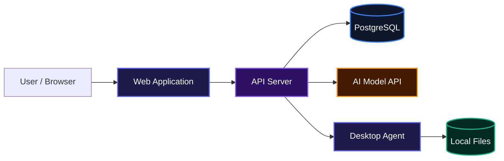
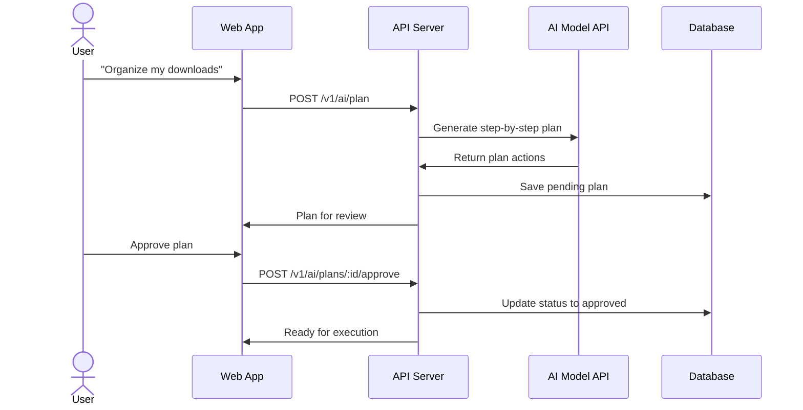
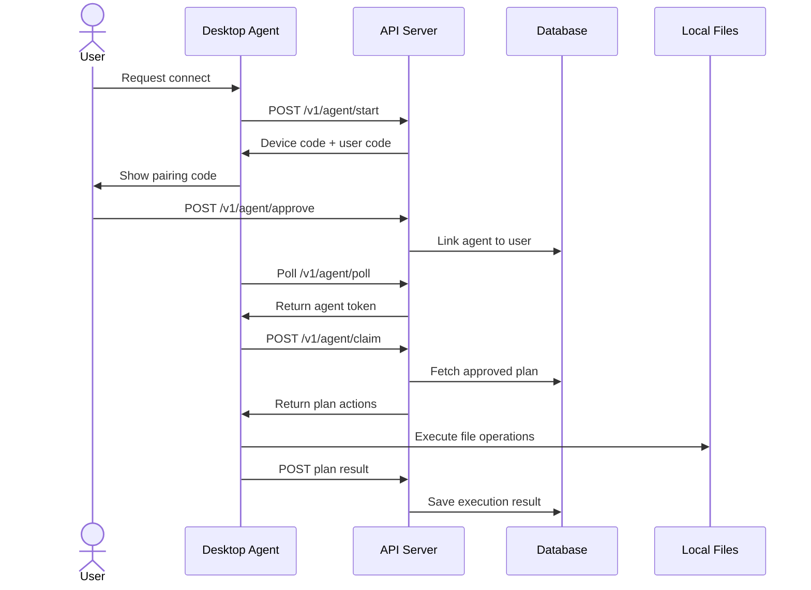
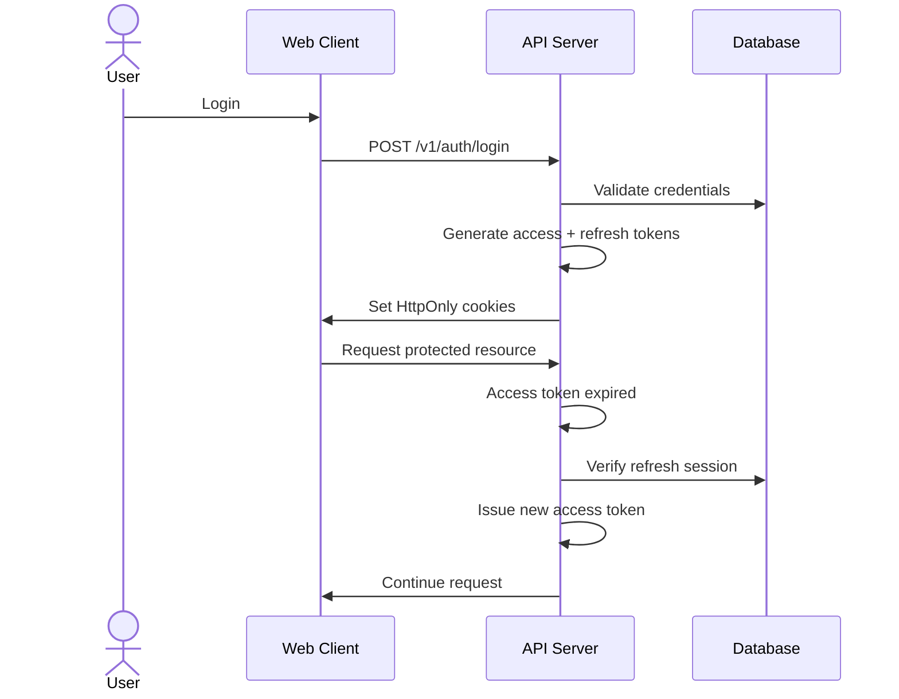

# Visual Workflow Agent

A local-first AI assistant that turns plain-language requests into safe, executable file-management workflows on your own computer.

## Overview

Visual Workflow Agent lets users describe file tasks in everyday language, review a step-by-step plan created by an AI, and approve it before anything touches their local files. Once approved, a lightweight desktop agent carries out the actions directly on the user's machine, so sensitive files never need to leave their computer.

The system bridges a cloud AI planning service with a secure local executor. Users get the convenience of natural language automation without giving up control or privacy over their personal files.

## System Architecture



## Features

- **Natural language file planning**: Describe what you want, such as "move all images from Downloads to a new folder on my desktop," and the system builds a structured plan.
- **Human-in-the-loop approval**: Every plan stays in a pending state until the user reviews and approves it. Nothing runs without explicit consent.
- **Secure local execution**: A desktop agent runs on the user's own machine and only operates inside the user's home directory.
- **JWT-based authentication**: Cookie-backed sessions with access tokens and refresh tokens, plus Google OAuth support.
- **Plan history and results**: Completed, rejected, and failed plans are stored for later review.

### AI Plan Generation and Approval



### Desktop Agent Pairing and Execution



### Authentication and Session Refresh



## Installation

1. Clone the repository:

```bash
git clone https://github.com/skido600/Visual-Workflow-Agent.git
cd Visual-Workflow-Agent
```

2. Install dependencies with pnpm:

```bash
pnpm install
```

3. Set up the server environment. Create `apps/server/.env` with the variables listed in the [Environment Variables](#environment-variables) section.

4. Run database migrations:

```bash
cd apps/server
pnpm drizzle-kit migrate
```

5. Start the development servers:

```bash
# From the repository root
pnpm dev
```

## Usage

After starting the project, the web frontend can ask the backend to generate a plan.

Example: creating a folder and moving a file.

```bash
curl -X POST http://localhost:3000/v1/ai/plan \
  -H "Content-Type: application/json" \
  -d '{"prompt": "Create a folder called Work on my desktop and move the report PDF into it"}'
```

The server returns a pending plan that the user reviews in the frontend. Once approved, the paired desktop agent picks up the plan, executes each file action, and reports the result back to the server.

To run only the server:

```bash
cd apps/server
pnpm dev
```

To run only the desktop agent:

```bash
cd apps/agent
pnpm dev
```

## API Documentation

All routes are prefixed with `/v1`. Authentication is handled via signed, HttpOnly cookies. Agent routes use a separate `Authorization: Bearer <agent-token>` header.

### Authentication

#### POST /v1/auth/register

Create a new account and send a verification email.

**Request**:

```json
{
  "username": "jane_doe",
  "email": "jane@example.com",
  "password": "securePassword123"
}
```

**Response**:

```json
{
  "success": true,
  "message": "Account created. Check your inbox to verify your email."
}
```

**Errors**:

- 400: Validation error
- 409: Username or email already exists

#### GET /v1/auth/verify-email

Verify an email address using the token sent by email.

**Query**: `?token=<verification_token>`

**Response**:

```json
{
  "success": true,
  "message": "Email verified successfully. You can now log in."
}
```

**Errors**:

- 400: Invalid or expired token

#### POST /v1/auth/resend-verification

Resend the verification email.

**Request**:

```json
{
  "email": "jane@example.com"
}
```

**Response**:

```json
{
  "success": true,
  "message": "A new verification link has been sent to your email."
}
```

#### POST /v1/auth/login

Log in with email and password.

**Request**:

```json
{
  "email": "jane@example.com",
  "password": "securePassword123"
}
```

**Response**:

```json
{
  "success": true,
  "message": "Login successful",
  "data": {
    "user": {
      "id": "uuid",
      "username": "jane_doe",
      "email": "jane@example.com",
      "displayName": "jane_doe",
      "avatarUrl": null
    }
  }
}
```

**Errors**:

- 400: Validation error
- 401: Invalid credentials
- 403: Email not verified

#### POST /v1/auth/forgot-password

Request a password reset OTP.

**Request**:

```json
{
  "email": "jane@example.com"
}
```

**Response**:

```json
{
  "success": true,
  "message": "If an account with that email exists, a password reset code will be sent."
}
```

#### POST /v1/auth/reset-password

Reset a password using the OTP sent by email.

**Request**:

```json
{
  "email": "jane@example.com",
  "otp": "123456",
  "newPassword": "newSecurePassword123"
}
```

**Response**:

```json
{
  "success": true,
  "message": "Password reset successfully. You can now log in."
}
```

**Errors**:

- 400: Invalid reset request

#### POST /v1/auth/verify-otp

Verify a password reset OTP without resetting the password yet.

**Request**:

```json
{
  "email": "jane@example.com",
  "otp": "123456"
}
```

**Response**:

```json
{
  "success": true,
  "message": "Reset code verified."
}
```

#### POST /v1/auth/logout

Invalidate the current session and clear authentication cookies.

**Auth required**: Yes

**Response**:

```json
{
  "success": true,
  "message": "Logged out successfully",
  "data": null
}
```

### OAuth

#### GET /v1/oauth/google

Get the Google OAuth URL.

**Response**:

```json
{
  "success": true,
  "url": "https://accounts.google.com/o/oauth2/v2/auth?..."
}
```

#### GET /v1/oauth/google/callback

Google OAuth callback. Sets authentication cookies and redirects to the frontend dashboard.

**Response**: 302 redirect to `/dashboard` or to `/error?message=...`

### AI Plans

#### POST /v1/ai/plan

Generate a new file-management plan from a natural language prompt.

**Auth required**: Yes

**Request**:

```json
{
  "prompt": "Create a folder called Work on my desktop and move the report PDF into it"
}
```

**Response**:

```json
{
  "success": true,
  "message": "Plan generated. Review it before approving.",
  "data": {
    "id": "uuid",
    "userId": "uuid",
    "goal": "Create a folder called Work on the desktop and move the report PDF into it",
    "plan": {
      "goal": "...",
      "explanation": "...",
      "actions": [...]
    },
    "status": "pending_approval",
    "createdAt": "...",
    "updatedAt": "..."
  }
}
```

**Errors**:

- 400: Invalid request body
- 401: Authentication required
- 502: AI service error

#### POST /v1/ai/plans/:planId/approve

Approve a pending plan so the desktop agent can execute it.

**Auth required**: Yes

**Response**:

```json
{
  "success": true,
  "message": "Plan approved. Ready for execution.",
  "data": {
    "id": "uuid",
    "goal": "...",
    "status": "approved"
  }
}
```

**Errors**:

- 400: Invalid plan ID
- 401: Authentication required
- 409: Plan not found or already reviewed

#### POST /v1/ai/plans/:planId/reject

Reject a pending plan.

**Auth required**: Yes

**Response**:

```json
{
  "success": true,
  "message": "Plan rejected. No actions will be executed.",
  "data": {
    "id": "uuid",
    "goal": "...",
    "status": "rejected"
  }
}
```

### Agent Pairing and Execution

#### POST /v1/agent/start

Start the device pairing flow for a desktop agent.

**Response**:

```json
{
  "success": true,
  "data": {
    "deviceCode": "...",
    "userCode": "ABCD-1234",
    "verificationUrl": "https://.../connect-agent?code=ABCD-1234",
    "expiresIn": 600
  }
}
```

#### POST /v1/agent/approve

Approve a pairing code from an authenticated user account.

**Auth required**: Yes

**Request**:

```json
{
  "userCode": "ABCD-1234"
}
```

**Response**:

```json
{
  "success": true
}
```

**Errors**:

- 400: Invalid or expired code

#### POST /v1/agent/poll

Poll for the pairing status using the device code.

**Request**:

```json
{
  "deviceCode": "..."
}
```

**Response when approved**:

```json
{
  "success": true,
  "data": {
    "token": "agent-token"
  }
}
```

**Response when pending**:

```json
{
  "success": true,
  "status": "pending"
}
```

**Errors**:

- 400: Pairing expired or already used

#### POST /v1/agent/claim

Claim the next approved plan for execution.

**Auth required**: Agent token

**Response**:

```json
{
  "success": true,
  "data": {
    "id": "uuid",
    "goal": "...",
    "plan": {
      "goal": "...",
      "explanation": "...",
      "actions": [...]
    },
    "status": "executing"
  }
}
```

**Response when no plan available**: 204 No Content

#### POST /v1/agent/plans/:planId/result

Report the result of an executed plan.

**Auth required**: Agent token

**Request**:

```json
{
  "status": "completed",
  "results": [...]
}
```

**Response**:

```json
{
  "success": true,
  "message": "Execution result saved successfully.",
  "data": {
    "id": "uuid",
    "goal": "...",
    "status": "completed",
    "executionResult": [...]
  }
}
```

#### GET /v1/agent/result/:planId

Get the execution result of a specific plan.

**Auth required**: Yes

**Response**:

```json
{
  "success": true,
  "message": "Execution result retrieved successfully.",
  "data": {
    "id": "uuid",
    "goal": "...",
    "status": "completed",
    "executionResult": [...],
    "updatedAt": "..."
  }
}
```

#### GET /v1/agent/history

List completed, rejected, and failed plans for the authenticated user.

**Auth required**: Yes

**Response**:

```json
{
  "success": true,
  "data": [
    {
      "id": "uuid",
      "goal": "...",
      "status": "completed",
      "executionResult": [...],
      "createdAt": "...",
      "updatedAt": "..."
    }
  ]
}
```

### Local Desktop Agent Endpoints

The desktop agent exposes a small local Hono server for the web frontend to trigger pairing and execution.

#### GET /health

Check whether the agent is running.

**Response**:

```json
{
  "success": true,
  "message": "Desktop agent is running"
}
```

#### GET /status

Check whether the agent is connected and whether it is currently executing a plan.

**Response**:

```json
{
  "success": true,
  "connected": true,
  "running": false
}
```

#### POST /connect

Start the pairing flow with the backend.

**Response**:

```json
{
  "success": true,
  "alreadyConnected": false
}
```

#### POST /execute

Trigger execution of the next approved plan.

**Response**:

```json
{
  "success": true,
  "status": "completed",
  "results": [...]
}
```

## Environment Variables

### Server (`apps/server/.env`)

```bash
DATABASE_URL="postgresql://..."
COOKIE_SECRET="..."
JWT_ACCESS_SECRET="..."
JWT_REFRESH_SECRET="..."
GOOGLE_CLIENT_ID="..."
GOOGLE_CLIENT_SECRET="..."
APP_URL="http://localhost:3000"
FRONTEND_URL="http://localhost:5173"
SESSION_SECRET="..."
META_MODEL_NAME="..."
META_MODEL_API_URL="..."
META_MODEL_API_KEY="..."
AGENT_TOKEN="..."
WEB_URL="..."
NODE_ENV="development"
```

### Desktop Agent (`apps/agent/.env`)

```bash
API_URL="http://localhost:3000"
PORT=3001
WEB_URL="https://..."
```

## Technologies Used

| Technology | Description |
|------------|-------------|
| [TypeScript](https://www.typescriptlang.org/) | Typed JavaScript for both server and agent |
| [Hono](https://hono.dev/) | Fast, lightweight web framework for the API and local agent |
| [Drizzle ORM](https://orm.drizzle.team/) | Type-safe SQL-like ORM for database operations |
| [PostgreSQL](https://www.postgresql.org/) | Relational database for users, sessions, plans, and agent pairings |
| [Zod](https://zod.dev/) | Runtime schema validation for requests and environment variables |
| [Google APIs](https://github.com/googleapis/google-api-nodejs-client) | Google OAuth integration |
| [Meta AI API](https://ai.meta.com/) | Model used to generate file-management plans |
| [Bun](https://bun.sh/) | Runtime and package manager for the server app |
| [pnpm](https://pnpm.io/) | Monorepo package manager |
| [Turborepo](https://turbo.build/) | Build system and task orchestration |

## Contributing

Contributions are welcome. If you would like to improve the project, please open an issue or pull request on GitHub. When making changes, keep the existing code style and make sure the TypeScript type checker passes.

## Author

Built by [skido600](https://github.com/skido600)

## Badges

[](https://www.typescriptlang.org/)
[](https://hono.dev/)
[](https://www.postgresql.org/)
[](https://orm.drizzle.team/)
[](https://pnpm.io/)
[](https://bun.sh/)
[](https://turbo.build/)

[](https://dokugen.samueltuoyo.com)